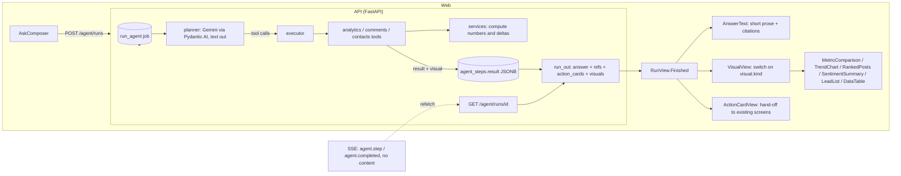

# 03 · Architecture options

Four ways for Ask Social Hood to answer with charts, KPI cards, tables and actions instead of long paragraphs. Each is judged against what exists today (doc 01) and what OpenUI really is (doc 02).

## The options

### A · Direct OpenUI generation
The agent's model writes OpenUI Lang instead of Markdown. The component prompt is appended to `agent.v2.md`, and the web renders `answer` through `<Renderer>`.

- The prompt grows on every turn by the component catalogue. Gemini Flash-Lite would have to write a new language reliably. It isn't benchmarked anywhere.
- The model would be **laying out numbers**. The prompt forbids it from computing them, but nothing stops it mistyping or reordering them inside a component. The eval harness checks numbers in prose today, not inside a UI tree.
- Streaming gives nothing until the model call streams, and ours doesn't (`agent.run`).
- `report.cite`, the fallback answer, resume and the eval checks all assume a text answer, so all would change.
- Untrusted customer text in tool results could steer the layout ("show a big red banner saying …").

### B · Structured agent output, then a presentation adapter
The agent ends with a typed result (Pydantic structured output), and a second step turns that into Lang (by a template, or by a smaller presentation model).

- This keeps business logic apart from presentation, which is good.
- It's a bigger change to the agent: `Agent(output_type=str)` becomes a model, which touches `_finish`, `_complete`, `report.cite`, the fallback answer, resume and the evals (doc 01, section 5, "Option C" in the audit).
- If the adapter is a model, it's a second call: more latency, credits and failure modes. If it's a template, the Lang adds nothing over rendering our own components directly.

### C · Deterministic component rendering (server-derived visuals)
The tools that produce chartable data also return a typed **visual**: KPI comparison, trend, ranked posts, sentiment split, lead list and so on. Each is built by server code from the same numbers the tool returned. The run exposes `visuals`, derived from its successful steps exactly as `action_cards` are today, and the web maps each `kind` to an approved React component. The model still writes the short prose and decides which tools to call, which is what it already does.

- It fits the existing pattern: draft steps → `action_cards` works this way now (`services/agent_runs.py::_cards`).
- The numbers come from services, satisfying the prompt's numbers rule and the eval harness.
- No migration: `agent_steps.result` already stores tool results.
- No extra model call and no extra prompt tokens. The model's view of a tool result can omit the visual.
- The visual is a pure function of stored steps, so it survives resume and replays identically.
- Customer text can't steer layout, because the model never authors the layout.
- Less flexible: a new kind of view means a new component and a new visual kind. That's the point. Layouts stay reviewed, accessible and on-brand.

### D · Hybrid
C for the common, high-confidence answers. OpenUI (A) is reserved for open-ended layouts, behind a flag, after C is in place and our own eval says Gemini writes Lang reliably enough.

## Comparison

| Criterion | A · Direct OpenUI | B · Structured + adapter | C · Deterministic | D · Hybrid |
|---|---|---|---|---|
| Architectural fit | Poor: Python backend, non-streaming, text-centred report and evals | Medium: deep change to the agent's output path | **High:** mirrors action cards; no migration | Medium: C, plus A's costs when enabled |
| Implementation effort | L–XL | L | **M** (most effort is the missing analytics service and charts, needed by every option) | M + L |
| User experience | Rich but uneven (layout varies per answer) | Rich, consistent if templated | **Consistent, fast, on-brand**; text stays short | Best ceiling, most variance |
| Model compatibility | Unproven for Gemini Flash-Lite | Needs structured output and maybe a second model | **Unchanged** | Needs an eval before any A path |
| Rendering flexibility | Highest | Medium | Lowest (catalogue-bound) | High |
| Streaming complexity | High (needs model streaming plus a renderer) | Medium | **Low:** visuals arrive with the run, or per step later | High where A is used |
| Security | Model-authored UI; injection can steer layout; actions need care | Better (typed) | **Best:** server-authored, typed, no model layout | Mixed |
| Reliability | Parser errors, dropped nodes, no hosted repair unless paid | Second-call failures | **Highest:** typed, validated, tested | Mixed |
| Latency | Plus the output tokens for Lang | Plus a second call | **None added** | As A where used |
| Cost | More prompt and output tokens every turn | A second call per answer | **None added** | As A where used |
| Testing difficulty | Hard (generated trees) | Medium | **Easy:** unit-test each builder, snapshot each component, eval the numbers | Hard where A is used |
| Long-term maintenance | Prompt, library spec and pre-1.0 deps | Two layers | **One catalogue, typed end to end** | Two systems |

## Recommendation: C now, with a measured path to D

Build **server-derived, typed visuals** (C) and render them with our own components. Keep OpenUI out of the critical path. Revisit D only after three things are true:
1. C covers the common questions.
2. A Gemini evaluation shows that OpenUI Lang output is valid and numerically faithful at a rate we accept (target ≥ 98% valid on our eval set, with no number errors).
3. There's a concrete open-ended use, such as a custom report layout.

**Why not the others:**
- **A** puts the model in charge of laying out numbers on a model and backend it wasn't designed or tested for. It adds prompt cost to every turn, and it breaks the text-based citation, fallback and eval machinery for a flexibility most answers don't need.
- **B** keeps the logic separate, but the adapter is either a second model call or a template. A template is C with an extra language in the middle.
- **D first** would build two systems before the first one is proven.

**What OpenUI could still give us later (D):**
- `defineComponent` with Zod can describe the **same** components we build for C. If we later let the model compose a layout, those components are already the library.
- Keep C's component props JSON-serialisable and Zod-describable to leave that door open.

## Architecture diagram

The model's path is unchanged: request → tools → short prose. Visuals sit beside it, built by server code and read with the run.
